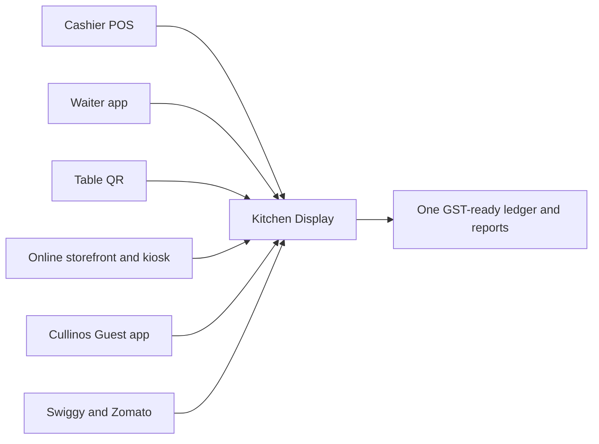

# Cullinos — Agency & Creator Brief

A single document for marketing agencies, content creators, and anyone who needs to understand and explain **Cullinos**. Read it once and you should be able to describe every part of the product, pick the right story for the right audience, and avoid claims we cannot back up.

| | |
|---|---|
| **Product** | Cullinos — Restaurant Operating System |
| **Company** | Rkyves (Mumbai, India) |
| **Website** | https://cullinos.com |
| **Contact** | hello@rkyves.com |
| **Brief version** | 2026-10 |

PDF version: `docs/client/export/pdf/Cullinos_Agency_Brief.pdf` (regenerate with `npm run client:export`).

---

## 1. Cullinos in one page

**Cullinos is your food business operating system.**

One login runs your cashier, kitchen, QR and online orders, the Cullinos Guest marketplace app, production, and reports, for restaurants, cafes, food trucks, bakeries, cloud kitchens, bars, and hotels. GST billing is built in.

It is made by **Rkyves**, a Mumbai-based software company, and is built India-first: GST invoices, Razorpay and Cashfree payments, MSG91 SMS and WhatsApp, and phone-OTP login.

**Three things to remember:**

| Pillar | What it means |
|--------|---------------|
| **GST-ready billing** | CGST, SGST, and IGST are built into every bill, not bolted on later. |
| **Every order channel, one kitchen** | Cashier POS, waiter app, table QR, online storefront, kiosk, the Guest app, and Swiggy / Zomato orders all land on the same kitchen screen. |
| **Scales with you** | The same platform runs a single food truck and a multi-outlet hotel group. |

**The one-line pitch:** *Stop juggling five apps to run one restaurant. Cullinos runs billing, kitchen, orders, stock, and marketing as one live system.*

---

## 2. The problem we solve

A typical Indian restaurant today runs on a patchwork:

- A billing machine or basic POS at the counter
- Paper kitchen tickets (KOTs) that get lost, smudged, or misread
- Separate tablets for Swiggy and Zomato
- Excel sheets or a notebook for stock and purchases
- WhatsApp groups to coordinate staff
- A separate tool (or nothing) for loyalty, SMS, and customer data

Every tool has its own menu, its own prices, and its own login. Nothing talks to anything else. Owners don't see the real picture until the end of the day, if at all.

**Cullinos replaces the patchwork with one live system.** Change a price once and it updates on the POS, the QR menu, the kiosk, and the Guest app. An order from any channel shows up on the kitchen screen instantly. Sales, stock, and customers are all in one dashboard.

---

## 3. How it works

1. **Set up your outlet.** Add your menu, tables, staff, and GST settings in the Admin dashboard.
2. **Take orders anywhere.** Use the POS, the waiter app, table QR codes, the online storefront, a kiosk, or the Guest app. They are all connected.
3. **The kitchen stays in sync.** Orders appear on the Kitchen Display instantly, whether they come from the floor, the web, the app, or an aggregator.
4. **Track and grow.** See sales, inventory, customers, and reports. Add outlets when you're ready.

---

## 4. The apps, explained like a person would use them

Cullinos is not one big screen. Each role gets its own focused app, and they all share the same live data.

| App | Who uses it | What it does | A moment you can film |
|-----|-------------|--------------|------------------------|
| **POS** (browser + Windows desktop) | Cashier | Fast touch billing, modifiers ("extra cheese"), hold and resume orders, takeaway, cash and online payments, GST receipts | A cashier rings up a busy lunch rush in seconds and the receipt prints instantly |
| **Portal POS** | Counter teams | The full cashier screen inside the Admin dashboard, so small outlets don't need a separate device | Owner billing from the same laptop they manage the menu on |
| **Kitchen Display (KDS)** | Kitchen staff | Live order tickets on a screen, routed to the right station (grill, bar, desserts); tap to mark items ready | A new order "pops" onto the kitchen screen the moment a guest orders from their table |
| **Order Display (CDS)** | Guests at the counter | A "Preparing / Ready" board so customers know when to collect | Order number flips from Preparing to Ready on a TV |
| **Promo display** | Guests in the venue | A playlist of offers and promos on a TV or tablet | In-store TV cycling through today's specials |
| **Waiter app** (Android) | Floor staff | Table map, take orders at the table, send straight to kitchen, start a QR session for guests | Waiter takes an order on a phone; kitchen screen updates before they walk away |
| **Admin dashboard** | Owner / manager | Menu, prices, staff, stock, purchasing, customers, loyalty, reports, Guest app listing and banners, billing | Owner changes a dish price once and it updates everywhere |
| **Management console** | Chain / multi-outlet operators | Compare outlets, network KPIs, move stock between outlets, franchise visibility | Side-by-side view of three outlets' sales for the day |
| **Cullinos Guest app** (Android) | Diners | Discover nearby restaurants, browse menus, order dine-in / takeaway / delivery, reorder favourites, loyalty, order-status push notifications | Diner finds a cafe nearby, orders, and gets a "Your order is ready" notification |
| **Online storefront & table QR** (web) | Diners | Branded web menu and ordering at `guest.cullinos.com`; scan a table QR to order into the table's bill | Guest scans the QR on the table, orders, and food arrives without waving down a waiter |

---

## 5. Full feature tour

Every feature below is live today unless marked otherwise. Each line gives what it is and why a restaurant cares.

### 5.1 Front of house (the service floor)

| Feature | What it is | Why it matters |
|---------|------------|----------------|
| **Point of Sale** | Touch checkout with modifiers, holds, takeaway, discounts, split bills, GST receipts | Faster billing, shorter queues, compliant invoices |
| **Cashier shifts** | Open / close shifts with cash-drawer accountability | Owners know exactly who handled the cash and when |
| **Waiter app** | Mobile table-side ordering with live status | Fewer trips to the counter, fewer wrong orders |
| **Table management** | Table map, capacity, merge / transfer tables, service requests | Smooth turnover on busy nights |
| **Table sessions & QR** | Waiter opens a table, guests scan a QR and add to the same bill | Guests order more, staff do less running |
| **Reservations** | Book tables from Admin, plus a public booking link for guests | Fill tables in advance; share the link on Instagram or Google |
| **Kitchen Display (KDS)** | Live kitchen tickets with station routing and ready states | No lost paper tickets; the kitchen sees everything in order |
| **Kitchen Order Tickets (KOT)** | Kitchen tickets on screen or printed | Works for kitchens that still prefer paper |
| **Order Display (CDS)** | Customer-facing Preparing → Ready board | Less crowding at the counter, fewer "is my order ready?" questions |
| **Promo display** | Promo playlists on in-venue TVs or tablets | Turn idle screens into upsell screens |
| **Pickup queue** | Ready-queue workflow for counters and QSR | Fast-food style order flow |

### 5.2 Customer ordering channels

| Feature | What it is | Why it matters |
|---------|------------|----------------|
| **QR dine-in ordering** | Scan the table QR and order into the active table session | Self-service ordering without a separate app download |
| **Online storefront** | Branded menu and ordering link per outlet | Commission-free direct orders the restaurant owns |
| **Digital ordering / kiosk** | Self-serve kiosk mode with launcher links | Shorter queues in cafes and QSRs |
| **Guest checkout** | Order with just a name and phone number; login is optional | No friction for first-time guests |
| **Phone OTP login** | Returning customers log in with a one-time code | Easy repeat ordering, no passwords |
| **Loyalty portal** | Customers can view their loyalty status on the storefront | Keeps guests coming back |
| **Cullinos Guest app** | Android marketplace app for diners (see 5.3) | A direct channel to diners, outside aggregator apps |
| **Deep links** | Shareable links that open a specific outlet in the app or web | Perfect for bios, posts, and ads |

### 5.3 Cullinos Guest app (for diners)

| Feature | What it is |
|---------|------------|
| **Nearby marketplace** | Discover restaurants near you |
| **Browse & order** | Menus, cart, dine-in / takeaway / delivery |
| **Easy login** | Phone OTP, with an optional PIN |
| **Orders & reorder** | Order history and one-tap reorder |
| **Favourites & reviews** | Save favourite outlets and leave reviews |
| **Saved addresses** | Faster delivery checkout |
| **Loyalty wallets** | Points and stamps visible in the app |
| **Push notifications** | Order status updates plus offers and campaigns |
| **Coupons & offers** | Discount codes applied at checkout |
| **Discover sections** | Curated home rows such as cuisine collections and seasonal picks |
| **Banners** | Home and discover banners for outlets and offers |

What restaurants control: their **app listing** (how they appear in the marketplace) and their **banners**, from Admin. Featured placement, Discover curation, and app-wide push campaigns are run by the Rkyves team.

### 5.4 Back office (running the business)

| Feature | What it is | Why it matters |
|---------|------------|----------------|
| **Menu management** | Categories, items, modifiers, pricing, availability | One menu, updated everywhere at once |
| **Happy hours** | Time-based pricing (for example, bar happy hours) | Price changes run automatically, without staff doing it by hand |
| **Inventory** | Stock levels and adjustments per outlet | Know what's running low before it runs out |
| **Recipes & costing** | Link ingredients to dishes | Know the true cost and margin of every plate |
| **Purchasing & POs** | Purchase orders and goods receipt | Track what was ordered and what arrived |
| **Suppliers** | Supplier directory | All vendors in one place |
| **Wastage** | Log waste against stock | See where money is being thrown away |
| **Production & batches** | Scale recipes, schedule and complete batches | Built for bakeries and central kitchens |
| **Central kitchen** | Outlets request stock from a central kitchen that fulfils them | Run a hub-and-spoke kitchen network |
| **Brands** | Multiple brands / menus from one kitchen | Built for cloud kitchens |
| **Staff & roles** | Owner, manager, cashier, waiter, kitchen, and more, each with their own access | Staff only see what they need |
| **Devices & printing** | Register devices; receipt and KOT print setup | Works with thermal printers and cash drawers |
| **Reports** | Sales, top items, outlet performance | Real numbers, not guesswork |
| **ERP day-book export** | Daily accounting export | Easier hand-off to the accountant |
| **Setup wizard** | Pick your business type, add GSTIN and order types | Up and running quickly |

### 5.5 Orders & payments

| Feature | What it is |
|---------|------------|
| **Unified orders** | Every order from every channel in one list: create, confirm, hold, resume, cancel |
| **Discounts & split bills** | Item or bill-level discounts; split a bill between guests |
| **Payments** | Cash, plus online payments through the restaurant's own Razorpay or Cashfree account |
| **Refunds** | Cancelling a paid online order refunds it through the payment gateway where possible; otherwise staff confirm the refund on the gateway dashboard |
| **GST tax engine** | Tax groups and automatic CGST / SGST / IGST calculation |
| **Delivery management** | Track delivery orders from Admin |
| **Aggregators** | Swiggy and Zomato orders flow in alongside your own, with settlement tracking |
| **Feedback surveys** | Post-order survey links for guests |

### 5.6 CRM & growth (marketing tools for the restaurant)

| Feature | What it is | Why it matters |
|---------|------------|----------------|
| **Customer CRM** | Customer profiles, order history, tiers | Know your regulars |
| **Loyalty** | Stamps, points, and rewards | Turn first-timers into regulars |
| **Coupons** | Discount codes across channels | Run offers anywhere |
| **SMS campaigns** | Marketing SMS through MSG91, paid from a prepaid wallet | Reach customers directly |
| **WhatsApp e-bills** | Send bills to customers on WhatsApp (pay-per-message from the wallet) | Paperless receipts plus a direct WhatsApp touchpoint |
| **Events & pop-ups** | Pre-orders for events | Built for pop-ups, catering, and festivals |
| **Privacy & consent** | Consent tracking, data export and erase | Built with India's DPDP privacy law in mind |

### 5.7 Enterprise (chains, franchises, cloud kitchens)

| Feature | What it is |
|---------|------------|
| **Multi-outlet console** | Network KPIs and side-by-side outlet comparison |
| **Stock transfer** | Move inventory between outlets |
| **Franchise tools** | Visibility into franchisee outlets |
| **Multi-brand** | Run multiple brands from shared kitchens |
| **Advanced analytics** | Network dashboards and exports |
| **API access** | Connect Cullinos to custom tools and workflows |

### 5.8 Hospitality (hotels & resorts)

| Feature | What it is |
|---------|------------|
| **Room service** | In-room dining orders routed to the kitchen |
| **Room posting** | Charge food and drinks to the guest's room bill (folio) |
| **Banquets** | Menus, packages, and billing for weddings, conferences, and large events |
| **Hotel guest profiles** | Guest records for hotel F&B |

### 5.9 Bars & pubs

Bars get a dedicated setup: an automatic Bar station on the kitchen display, happy-hour pricing, pour-size recipes tracked against bottle stock, a liquor stock register with CSV export, and a State Excise tax group.

---

## 6. Who it's for

### Verticals

| Vertical | The story to tell |
|----------|-------------------|
| **Restaurants** | Tables, waiter app, QR dine-in, kitchen display, and full back office in one system |
| **Cafes & QSR** | Lightning-fast counter billing, Ready board, loyalty, kiosk |
| **Food trucks & pop-ups** | POS on a phone or tablet, events and pre-orders, quick service |
| **Bakeries** | Production batches, recipes, pre-orders |
| **Cloud kitchens** | Multiple brands, delivery, Swiggy / Zomato orders in one kitchen screen |
| **Catering** | Events, pre-orders, production planning |
| **Bars & pubs** | Happy hours, bar station, pour-size stock, liquor register |
| **Hotels & resorts** | Room service, charge-to-room, banquets |

### Personas

| Persona | What they worry about | What to show them |
|---------|----------------------|-------------------|
| **Owner (single outlet)** | Cash leakage, wrong orders, no time, too many apps | One dashboard, shift cash control, kitchen screen, GST bills |
| **Manager** | Rush hours, staff mistakes, stock running out | Waiter app, KDS, inventory alerts, reports |
| **Chain / franchise operator** | Consistency and visibility across outlets | Management console, outlet comparison, stock transfer, central kitchen |
| **Hotel F&B head** | Room service and banquet billing mess | Room posting, banquets, one platform for every outlet |
| **Diner** | Waiting, waving for the waiter, repeat ordering | Scan-and-order QR, Guest app, reorder, loyalty |

---

## 7. Plans and pricing (India, INR)

List prices; taxes as applicable. Yearly billing saves roughly two months.

| Plan | Monthly | Yearly | Best for | Includes |
|------|---------|--------|----------|----------|
| **Starter** | ₹1,499 | ₹14,999 | Single outlet launch | POS, KDS, tables, QR and online ordering, reports |
| **QSR / Food SMB** | ₹2,499 | ₹24,999 | Cafes, trucks, counters | Starter + counter mode, pickup queue, loyalty, inventory, production |
| **Professional** *(most popular)* | ₹4,999 | ₹49,999 | Growing restaurants | QSR + purchasing, CRM, delivery, Waiter app, up to 3 outlets |
| **Enterprise** | Contact us | Contact us | Chains & franchise | Professional + multi-outlet, multi-brand, franchise, analytics, API |
| **Hospitality** | Contact us | Contact us | Hotels & resorts | Enterprise + room service, room posting, banquets |

Enterprise and Hospitality are custom-quoted based on outlets, rooms, terminals, users, and integrations. Always point pricing questions to the [pricing page](https://cullinos.com) or hello@rkyves.com, since prices can change.

---

## 8. Integrations

| Integration | What it does |
|-------------|--------------|
| **Razorpay / Cashfree** | Online payments (UPI, cards, wallets) into the restaurant's own account |
| **MSG91** | Phone OTP login, marketing SMS, WhatsApp messages |
| **Firebase** | Guest app login and push notifications |
| **Swiggy / Zomato** | Incoming aggregator orders and settlements, alongside your own orders |
| **Printers & hardware** | Thermal receipt and kitchen printers, cash drawers, barcode scanners, display boards (via the Cullinos Local Gateway) |
| **Accounting** | Daily day-book export for your accountant |

---

## 9. Brand messaging kit

### Positioning statement

For Indian food businesses that are tired of juggling separate billing, kitchen, delivery, and marketing tools, **Cullinos** is the restaurant operating system that runs every role and every order channel on one live platform, with GST billing built in. Unlike a basic POS, Cullinos connects the cashier, kitchen, floor, guests, and owner, from one outlet to a hotel chain.

### Key messages

1. **One system, every service moment.** Billing, kitchen, floor, online, and back office, all connected.
2. **Every order reaches one kitchen.** POS, waiter, QR, app, and aggregator orders land on the same screen.
3. **Built for India.** GST invoices, UPI payments, SMS and WhatsApp, phone OTP.
4. **Each role gets its own app.** The cashier, the chef, and the waiter each see only what they need.
5. **Grows with you.** From a food truck to a franchise network, on the same platform.

### Tagline options (from approved copy)

- "Your food business operating system."
- "One system. Every service moment."
- "Every order channel. One kitchen."
- "From one outlet to hotel chains — same platform."
- "One login for cashier, kitchen, online orders, and reports."

### Tone of voice

- **Confident, practical, warm.** We talk like an experienced restaurant manager, not a software salesperson.
- **Show the moment, not the module.** Instead of "KDS with station routing", say "the grill sees the order the second it's placed."
- **India-first.** Use rupee prices, UPI, GST, chai-break and lunch-rush examples.
- **Plain language.** Explain jargon (see the glossary) or avoid it.

### Names to use exactly

| Use | Avoid |
|-----|-------|
| **Cullinos** | Culinos, Cullinos POS (it is more than a POS), CullinOS |
| **Cullinos Guest app** (or "the Cullinos app" for diners) | "Customer app", "Cullinos delivery app" |
| **Cullinos Waiter app** | "Captain app" |
| **Rkyves** (the company) | Rkyves POS, Rkives |
| **Kitchen Display** (KDS) | "Kitchen TV" |

---

## 10. Content ideas

### Reel and short-video hooks

| Feature | Hook idea |
|---------|-----------|
| QR ordering + KDS | "QR to kitchen in 10 seconds" — split screen of a guest scanning and the kitchen screen lighting up |
| POS | "Lunch rush, zero panic" — a cashier billing a queue at speed |
| Waiter app | "Your waiter just stopped walking to the counter" |
| Kitchen Display | "RIP paper KOTs" — a crumpled ticket next to a clean kitchen screen |
| Order Display | "No more 'is my order ready?'" |
| Menu sync | "Change the price once. Watch it update everywhere." |
| Inventory & recipes | "Do you actually know what your paneer tikka costs you?" |
| Shifts & cash control | "Who closed the drawer ₹500 short?" |
| Loyalty | "Turn first-timers into regulars" |
| WhatsApp e-bills | "Your bill, on WhatsApp, before you leave the table" |
| Aggregators | "Swiggy, Zomato, dine-in — one kitchen screen" |
| Guest app | "Found it, ordered it, picked it up" — a diner's journey |
| Multi-outlet | "Three outlets. One screen. Morning chai." — owner checking every outlet over breakfast |
| Bars | "Happy hour starts itself" |
| Hotels | "Room 304 ordered biryani — and it's already on their bill" |

### Series ideas

- **"A day in the life"**: follow one order from a guest's table QR scan to the kitchen, the Ready board, the bill, and the owner's report.
- **"Before / after Cullinos"**: the chaos of paper tickets and five tablets compared with one system.
- **"Owner confessions"**: real restaurant pain points (cash leakage, wrong orders, stock-outs), each answered by one feature.
- **"One feature, 30 seconds"**: a quick explainer for each feature in section 5.
- **Vertical spotlights**: one episode each for cafes, bakeries, cloud kitchens, bars, and hotels.

### 60-second demo script

| Time | Visual | Voiceover |
|------|--------|-----------|
| 0–5s | Messy counter: paper KOTs, three delivery tablets, a calculator | "Running a restaurant shouldn't need five apps." |
| 5–15s | Guest scans the table QR and orders on their phone | "Your guests order straight from the table…" |
| 15–25s | The order pops up on the kitchen screen; the chef taps Ready | "…and the kitchen sees it instantly. No paper, no shouting." |
| 25–35s | Waiter adds a dessert on the waiter app; the cashier bills on POS; the GST receipt prints | "Waiters, cashiers, and the kitchen all work from the same live order." |
| 35–45s | Owner on Admin: sales, stock, top dishes | "And you see sales, stock, and your best sellers in one dashboard." |
| 45–55s | Quick cuts: Guest app, loyalty, WhatsApp bill, multi-outlet view | "Loyalty, WhatsApp bills, your own ordering app, and every outlet in one view." |
| 55–60s | Cullinos logo + cullinos.com | "Cullinos. Your food business operating system." |

### Carousel / post ideas

- "5 signs your restaurant has outgrown its billing software"
- "What happens to an order in Cullinos" (step-by-step carousel)
- "GST billing without the headache"
- "Which Cullinos plan fits you?" (Starter, QSR, Professional, Enterprise, Hospitality)
- "The real cost of a dish" (recipe costing explainer)
- Customer story or testimonial template (only with written permission from the restaurant)

### Campaign themes by vertical

| Vertical | Campaign theme |
|----------|----------------|
| Cafes & QSR | "Faster queues, happier regulars" |
| Restaurants | "Run the floor, not the paperwork" |
| Cloud kitchens | "Many brands, one kitchen screen" |
| Bakeries | "Bake to plan, not to guess" |
| Bars & pubs | "Happy hours that run themselves" |
| Hotels | "Every outlet, every room, one system" |
| Chains | "Every outlet, one morning check" |

---

## 11. Assets & links

### Product visuals

Mockup illustrations are in `apps/web/public/images/`:

| File | Shows |
|------|-------|
| `mockup-pos.svg` | Point of Sale |
| `mockup-kds.svg` | Kitchen Display |
| `mockup-waiter.svg` | Waiter app |
| `mockup-ordering.svg` | QR / online ordering and Guest app |
| `mockup-admin.svg` | Admin dashboard |
| `mockup-enterprise.svg` | Multi-outlet / enterprise console |
| `flow-cloud.svg` | How every channel connects to one cloud |

For real screen recordings or a demo account, ask the Rkyves team. Never film or publish a real restaurant's customer data, phone numbers, or sales figures without written permission.

### Brand basics

- Colours: deep ink `#0F0F1A`, gold `#D4A017`, bright gold `#F5A623`, cream `#F7F4EE`
- Typefaces: **Fraunces** (headlines), **DM Sans** (body)

### Links

| What | URL |
|------|-----|
| Website | https://cullinos.com |
| Start a trial / contact | https://cullinos.com/contact?intent=trial |
| Restaurant Admin | https://admin.cullinos.com |
| Online ordering | https://guest.cullinos.com |
| Waiter app landing | https://waiter.cullinos.com |
| Multi-outlet console | https://manage.cullinos.com |
| Contact | hello@rkyves.com |

### Other documents you can request

- **Brochure**: short overview for first contact
- **Product Overview**: full feature catalogue
- **Plans Brochure**: plan comparison and pricing
- **User Manual**: how restaurant staff use the product

---

## 12. Do's and don'ts

### Do

- Show real service moments (rush hour, table QR, kitchen screen) rather than abstract dashboards.
- Say "GST-ready billing with CGST, SGST, and IGST".
- Say Swiggy and Zomato orders **come into** Cullinos alongside your own orders.
- Mention that the Guest app is on **Android**.
- Send any new claim, statistic, or customer quote to Rkyves for approval before publishing.

### Don't

| Don't say | Why | Say instead |
|-----------|-----|-------------|
| "Sync your menu to Swiggy / Zomato automatically" | Outbound menu sync is not available | "Swiggy and Zomato orders flow into the same kitchen screen" |
| "Fully integrated with your hotel PMS" | Deeper PMS sync is on the roadmap | "Charge F&B to the guest's room bill" |
| "AI-powered" | AI features are not live yet | Leave AI out |
| "Available on iPhone" | The Guest and Waiter apps are Android | "Available on Android" |
| "Full ERP / Tally integration" | We provide a day-book export, not a full ERP connector | "Daily accounting export for your accountant" |
| "100% GST compliant" / "government approved" / "e-invoicing built in" | Unverified compliance claims | "GST-ready billing" and "e-invoice readiness" |
| "Zero commission forever" or any savings figure | Not an approved claim | "Take direct orders on your own storefront" |
| "Free" | All plans are paid | "Plans from ₹1,499 a month" (check current pricing first) |
| Competitor names in negative comparisons | Legal and brand risk | Focus on the problem Cullinos solves |
| Fake reviews, invented customer names, or invented numbers | Misleading | Use real testimonials only with written permission |

---

## 13. Glossary

| Term | Meaning |
|------|---------|
| **POS** | Point of Sale: the billing screen at the counter |
| **KOT** | Kitchen Order Ticket: the order slip sent to the kitchen |
| **KDS** | Kitchen Display System: a screen in the kitchen that replaces paper KOTs |
| **CDS** | Customer Display / Order Display: the "Preparing / Ready" board guests watch |
| **QSR** | Quick Service Restaurant: counter-service places like cafes and fast food |
| **Cloud kitchen** | A delivery-only kitchen, often running several brands |
| **Central kitchen** | One kitchen that prepares food or stock for several outlets |
| **Aggregator** | Third-party delivery apps like Swiggy and Zomato |
| **GST** | India's Goods and Services Tax |
| **CGST / SGST / IGST** | Central, State, and Integrated GST: the tax parts shown on an Indian bill |
| **GSTIN** | A business's GST registration number |
| **HSN / SAC** | Tax classification codes printed on invoices |
| **Modifier** | An add-on or change to an item ("extra cheese", "no onion") |
| **Table session** | An open bill for a table that the waiter and guests can both add to |
| **Folio** | A hotel guest's room bill |
| **Room posting** | Charging restaurant orders to a hotel room's folio |
| **Banquet** | A large event (wedding, conference) with set menus and billing |
| **Indent** | A stock request from an outlet to a central kitchen |
| **PO / GRN** | Purchase Order / Goods Receipt Note: ordering and receiving stock |
| **Shift** | A cashier's working session, with cash counted at open and close |
| **Deep link** | A link that opens a specific restaurant directly in the app or web |
| **Push notification** | A pop-up message on the diner's phone from the Guest app |
| **OTP** | One-time password sent by SMS for login |
| **DPDP** | India's Digital Personal Data Protection Act |
| **UPI** | India's instant bank-to-bank payment system |

---

*Questions, approvals, demo access: hello@rkyves.com · https://cullinos.com · Mumbai, India*
